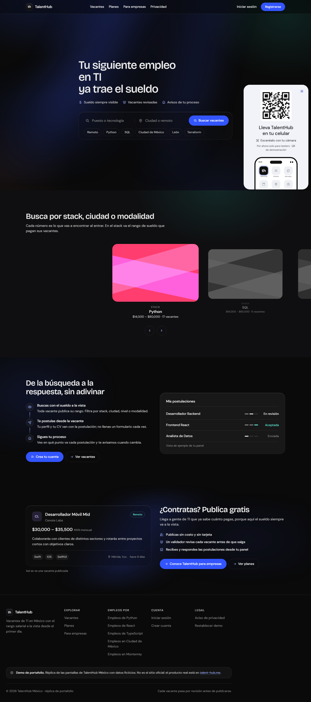
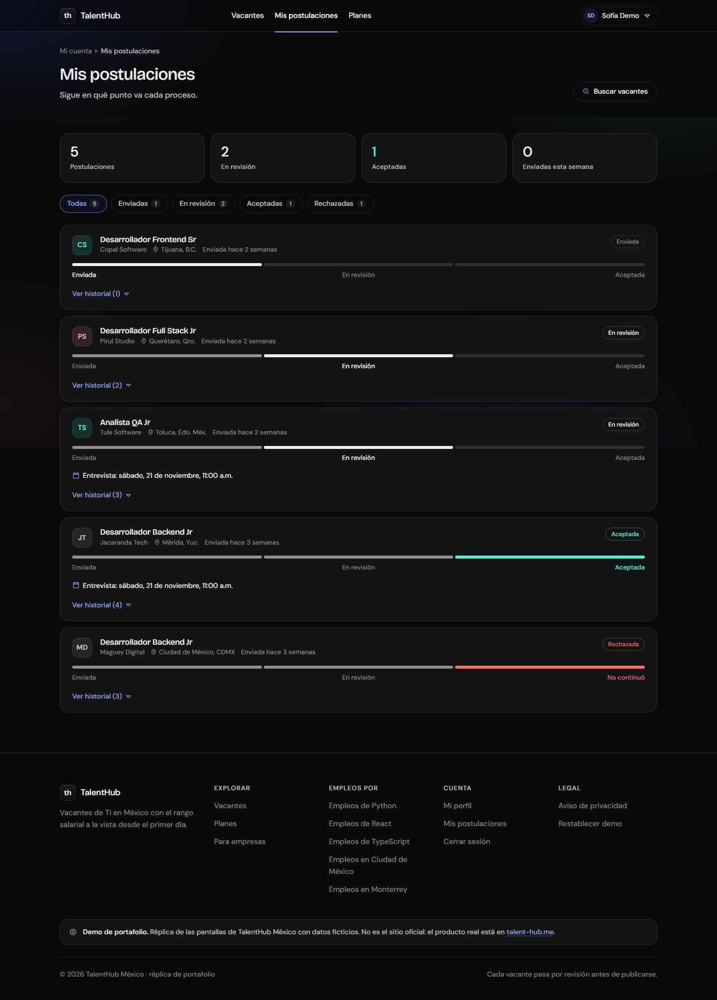
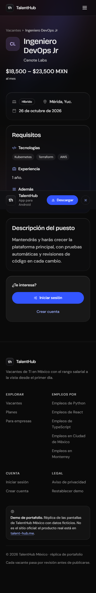

# TalentHub México — réplica de portafolio

> [!IMPORTANT]
> **Réplica de portafolio de las pantallas de TalentHub México, proyecto en el que participé. No es
> el sitio oficial; el producto real está en https://talent-hub.me**
>
> Todas las vacantes, empresas y personas son **ficticias**. El inicio de sesión y el registro son
> maquetas: no envían datos a ningún lado y no guardan contraseñas.

**Ver la demo:** https://jazyelae.github.io/Talent-hub-design/



## Sobre el proyecto

TalentHub México es una bolsa de trabajo de TI con un principio: **el rango salarial siempre
visible**. Candidatos buscan y siguen sus postulaciones; empresas publican vacantes (revisadas por
un validador) y responden desde su panel.

El repositorio original ya no existe. Este repo reconstruye y documenta el **diseño y la
experiencia de usuario** de sus pantallas, con la misma forma de trabajar que usé en el proyecto:
prototipar directamente en HTML y CSS en lugar de Figma.

### Mi rol

En TalentHub México participé como:

- **Diseñador UI/UX**: diseñé los prototipos directamente en HTML/CSS (en lugar de Figma), con el
  sistema de diseño oscuro con vidrio, los estados de cada pantalla y los flujos de candidato y
  empresa.
- **Desarrollador frontend**: implementación de las interfaces.
- **QA**: pruebas de los flujos, estados y comportamiento responsivo.

## Qué incluye la réplica

- **15 pantallas** (públicas, de candidato y de empresa) y sus estados de carga, vacío y error.
- **Funcionalidad simulada** en el navegador con datos de ejemplo (`/data/*.json`): búsqueda y
  filtros de vacantes (tecnología, nivel, modalidad, rango salarial), paginación, detalle,
  postulación con validación, seguimiento de postulaciones, perfil, publicación de vacantes y
  gestión de postulaciones recibidas. Los dos lados se conectan: lo que decide la empresa aparece
  en el seguimiento del candidato.
- **Responsiva** (390 / 768 / 1440 px verificados) y **accesible** (contraste WCAG AA, navegación
  con teclado, foco visible, etiquetas, textos alternativos, `prefers-reduced-motion`).
- **Sin frameworks ni compilación**: HTML5 semántico, CSS con capas y variables, JavaScript
  vanilla en módulos ES.

## Índice de pantallas

Cuentas demo sin contraseña: añade `?como=candidato` o `?como=empresa` a la URL, o usa los botones
de la pantalla de inicio de sesión.

| Pantalla | Usuario | Demo | Archivo | Captura |
|---|---|---|---|---|
| Inicio | Ambos | [abrir](https://jazyelae.github.io/Talent-hub-design/) | [index.html](index.html) | [ver](docs/capturas/inicio-escritorio.png) |
| Vacantes (búsqueda, filtros, paginación) | Candidato | [abrir](https://jazyelae.github.io/Talent-hub-design/vacantes.html) | [vacantes.html](vacantes.html) | [ver](docs/capturas/vacantes-filtros-escritorio.png) |
| Detalle de vacante y postulación | Candidato | [abrir](https://jazyelae.github.io/Talent-hub-design/vacante.html?id=163&como=candidato) | [vacante.html](vacante.html) | [ver](docs/capturas/vacante-detalle-escritorio.png) |
| Planes | Ambos | [abrir](https://jazyelae.github.io/Talent-hub-design/planes.html) | [planes.html](planes.html) | [ver](docs/capturas/planes-escritorio.png) |
| Para empresas | Empresa | [abrir](https://jazyelae.github.io/Talent-hub-design/empresas.html) | [empresas.html](empresas.html) | [ver](docs/capturas/empresas-escritorio.png) |
| Iniciar sesión *(maqueta)* | Ambos | [abrir](https://jazyelae.github.io/Talent-hub-design/login.html) | [login.html](login.html) | [ver](docs/capturas/login-escritorio.png) |
| Registro *(maqueta)* | Ambos | [abrir](https://jazyelae.github.io/Talent-hub-design/registro.html) | [registro.html](registro.html) | [ver](docs/capturas/registro-escritorio.png) |
| Recuperar contraseña *(maqueta)* | Ambos | [abrir](https://jazyelae.github.io/Talent-hub-design/recuperar.html) | [recuperar.html](recuperar.html) | [ver](docs/capturas/recuperar-escritorio.png) |
| Mis postulaciones | Candidato | [abrir](https://jazyelae.github.io/Talent-hub-design/mis-postulaciones.html?como=candidato) | [mis-postulaciones.html](mis-postulaciones.html) | [ver](docs/capturas/mis-postulaciones-escritorio.png) |
| Mi perfil | Candidato | [abrir](https://jazyelae.github.io/Talent-hub-design/perfil.html?como=candidato) | [perfil.html](perfil.html) | [ver](docs/capturas/perfil-escritorio.png) |
| Mis vacantes | Empresa | [abrir](https://jazyelae.github.io/Talent-hub-design/empresa/vacantes.html?como=empresa) | [empresa/vacantes.html](empresa/vacantes.html) | [ver](docs/capturas/empresa-vacantes-escritorio.png) |
| Publicar vacante | Empresa | [abrir](https://jazyelae.github.io/Talent-hub-design/empresa/publicar.html?como=empresa) | [empresa/publicar.html](empresa/publicar.html) | [ver](docs/capturas/empresa-publicar-escritorio.png) |
| Postulaciones recibidas | Empresa | [abrir](https://jazyelae.github.io/Talent-hub-design/empresa/postulaciones.html?como=empresa) | [empresa/postulaciones.html](empresa/postulaciones.html) | [ver](docs/capturas/empresa-postulaciones-escritorio.png) |
| Aviso de privacidad | Ambos | [abrir](https://jazyelae.github.io/Talent-hub-design/privacidad.html) | [privacidad.html](privacidad.html) | [ver](docs/capturas/privacidad-escritorio.png) |
| Página no encontrada | Ambos | [abrir](https://jazyelae.github.io/Talent-hub-design/no-existe) | [404.html](404.html) | [ver](docs/capturas/404-escritorio.png) |
| Guía de componentes | — | [abrir](https://jazyelae.github.io/Talent-hub-design/componentes.html) | [componentes.html](componentes.html) | [ver](docs/capturas/componentes-escritorio.png) |

**Estados demostrables** en cualquier lista: `?demo=lento` (servidor despertando),
`?demo=error` (error con reintentar) y `?demo=vacio`. Por ejemplo:
[vacantes con carga lenta](https://jazyelae.github.io/Talent-hub-design/vacantes.html?demo=lento).

| Escritorio | Móvil |
|---|---|
|  |  |

## Documentación de UX

| Documento | Contenido |
|---|---|
| [docs/ux-decisions.md](docs/ux-decisions.md) | Por pantalla: objetivo, usuario, flujo y decisiones justificadas (Nielsen, WCAG, mobile-first) |
| [docs/user-flows.md](docs/user-flows.md) | Diagramas Mermaid de los flujos del candidato y de la empresa |
| [docs/design-tokens.md](docs/design-tokens.md) | Paleta, tipografía y espaciado explicados |
| [docs/proceso.md](docs/proceso.md) | Por qué prototipar en HTML en lugar de Figma: ventajas, desventajas y aprendizajes |
| [docs/bitacora.md](docs/bitacora.md) | Decisiones de cada tarea de implementación |
| [docs/inventario.md](docs/inventario.md) | Relevamiento del sitio original (Fase 0) |
| [SPEC.md](SPEC.md) · [PLAN.md](PLAN.md) | Especificación y plan de trabajo |

## Ejecutar en local

Necesitas **Python 3** (solo para servir archivos; no hay dependencias que instalar). Los datos se
cargan con `fetch`, así que hay que abrirlo por HTTP, no con doble clic en el archivo.

```bash
git clone https://github.com/JazyelAe/Talent-hub-design.git
```

```bash
cd Talent-hub-design
```

```bash
python tools/servidor.py 8000
```

Abre http://127.0.0.1:8000. Para reiniciar los datos de la demo usa **«Restablecer demo»** en el pie
de página.

### Herramientas de QA (opcionales)

Con el servidor corriendo y Chrome o Edge instalados:

```bash
python tools/capturas.py --revisar
```

Revisa 20 pantallas a 390, 768 y 1440 px (desbordamiento horizontal) y corre la auditoría de
accesibilidad de [`tools/auditoria.js`](tools/auditoria.js).

```bash
python tools/capturas.py
```

Regenera las 40 capturas de `docs/capturas/`.

## Publicación en GitHub Pages

El sitio es estático y todas sus rutas son relativas, así que funciona tal cual:

1. En GitHub: **Settings → Pages → Build and deployment → Source: Deploy from a branch**.
2. Rama **`main`**, carpeta **`/ (root)`** → **Save**.
3. En uno o dos minutos queda en `https://<usuario>.github.io/Talent-hub-design/`.

`.nojekyll` evita el procesamiento de Jekyll y `404.html` se usa automáticamente para rutas
inexistentes.

## Estructura

```
├── index.html, vacantes.html, vacante.html, …   pantallas públicas y de candidato
├── empresa/                                      pantallas de empresa
├── css/
│   ├── tokens.css      variables de diseño (mismos nombres que el Tailwind original)
│   ├── base.css        reset, tipografía, foco, reduced-motion
│   ├── components/     un archivo por componente
│   └── pages/          estilos propios de cada pantalla
├── js/
│   ├── api.js          API simulada (retardo, ?demo=, localStorage)
│   ├── layout.js       nav, footer y aviso de la app
│   ├── components/     tarjeta, formularios, diálogos, estados, chips…
│   └── pages/          lógica de cada pantalla
├── data/               JSON ficticios (generados por tools/gen_data.py)
├── assets/             iconos Phosphor (MIT) y favicon
├── docs/               documentación de UX y capturas
├── referencias/        capturas del sitio original usadas como referencia
└── tools/              servidor local, generador de datos, auditoría y capturas
```

## Tecnologías y créditos

- HTML5, CSS (capas, custom properties, `:has()`, `clamp()`, `backdrop-filter`), JavaScript
  (módulos ES, `<dialog>`, validación nativa).
- Tipografías **Bricolage Grotesque** y **DM Sans** (Google Fonts).
- Iconos **[Phosphor](https://phosphoricons.com)** duotone, licencia MIT
  ([assets/icons/LICENSE](assets/icons/LICENSE)).
- El sistema de diseño (tokens, principios de color y movimiento) se basa en la guía de estilo
  del producto TalentHub México. Esta réplica no contiene datos ni código del producto real.
