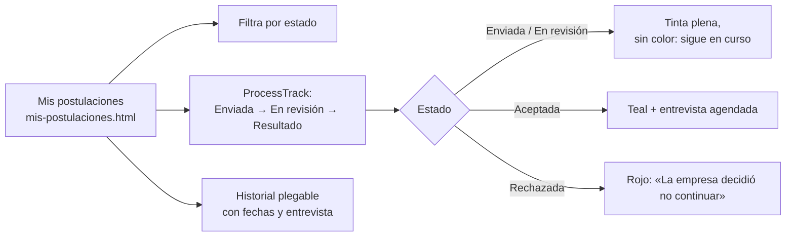
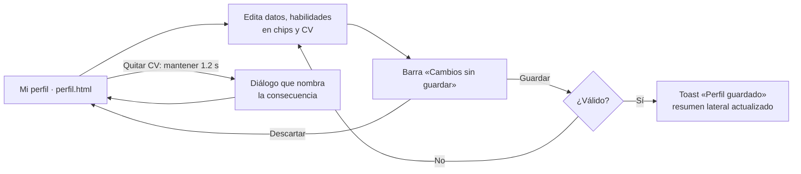
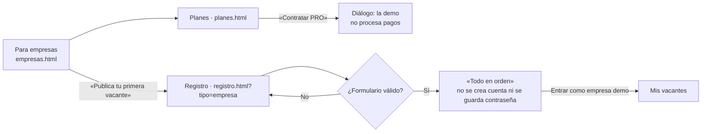
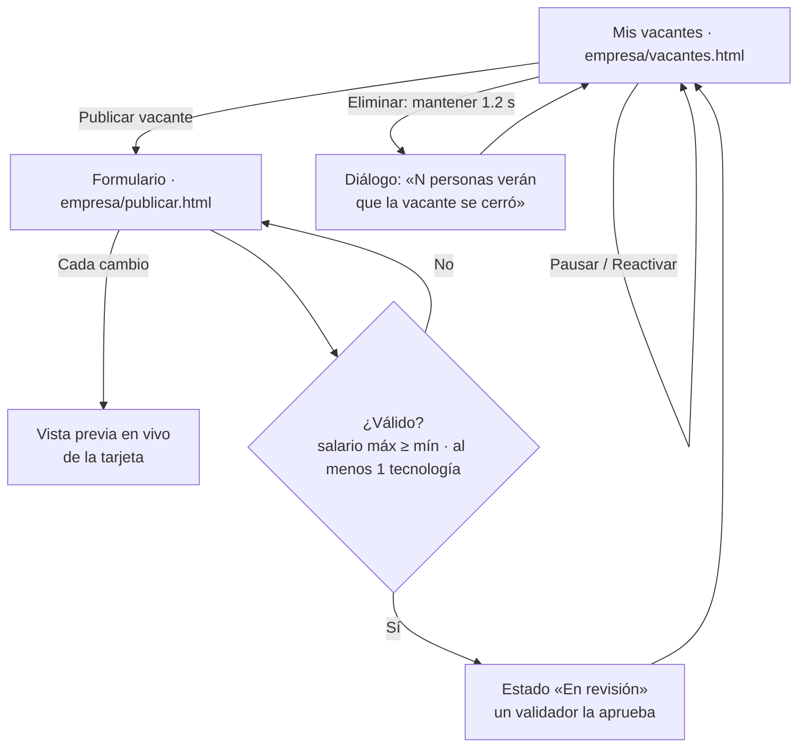
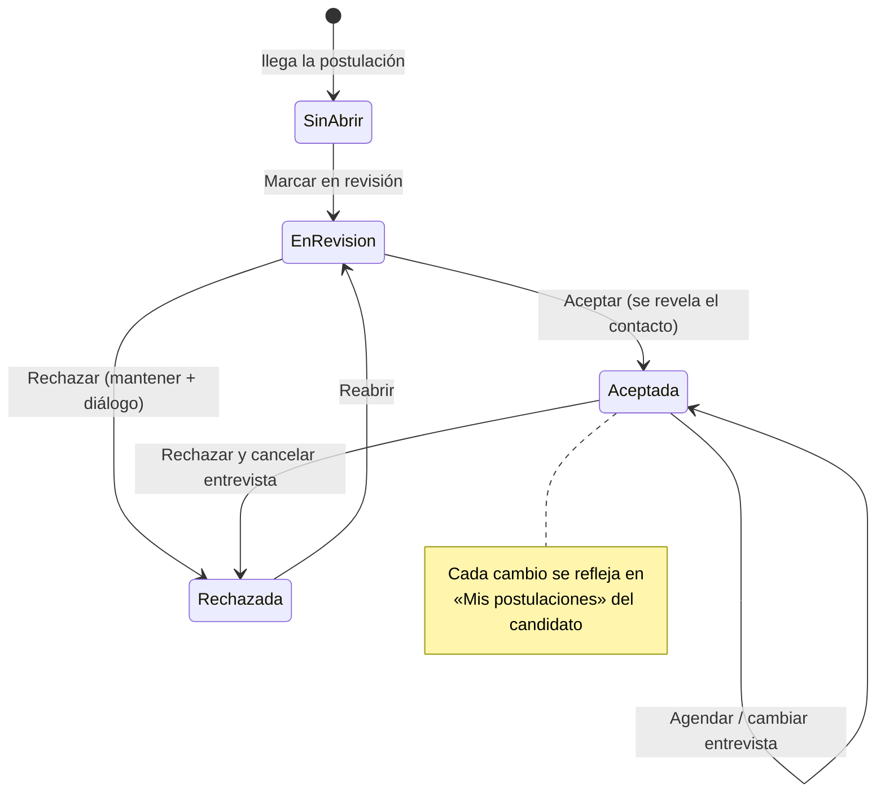
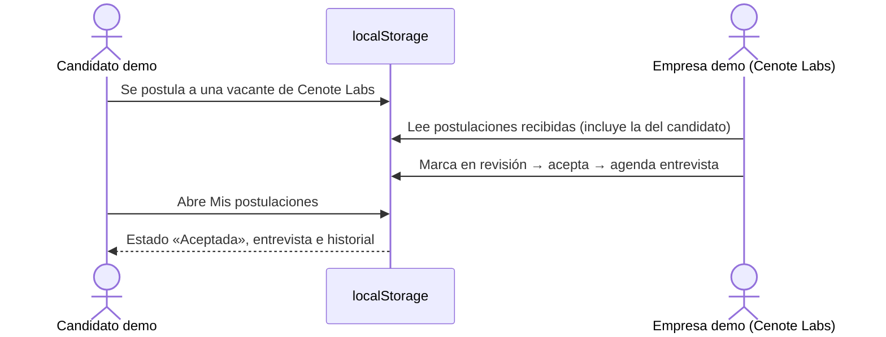

# Flujos de usuario

Diagramas de los flujos principales de la réplica. GitHub dibuja los bloques Mermaid directamente.
Cada nodo corresponde a una pantalla real del repo; los rombos son decisiones o validaciones.

## Candidato

### Buscar y postularse

```mermaid
flowchart TD
    A([Inicio · index.html]) -->|Escribe puesto / ciudad<br/>o elige búsqueda rápida| B[Vacantes · vacantes.html]
    B -->|Filtra: modalidad, tecnología,<br/>nivel, rango salarial| B
    B --> C{¿Hay resultados?}
    C -->|No| C1[Estado vacío:<br/>«Ninguna vacante coincide»] -->|Limpiar filtros| B
    C -->|Sí| D[Detalle · vacante.html?id=…]
    D --> E{¿Sesión de candidato?}
    E -->|No| F[Login · login.html?volver=…]
    F -->|«Candidato demo»<br/>(maqueta sin contraseña)| D
    E -->|Sí| G[Diálogo «Postularte a…»]
    G --> H{¿Formulario válido?<br/>CV PDF ≤ 5 MB · consentimiento}
    H -->|No| G1[Errores junto al campo<br/>+ foco al primero] --> G
    H -->|Sí| I[Toast «Postulación enviada»<br/>tarjeta: «Ya te postulaste»]
    I --> J[Mis postulaciones]
```

### Seguir el proceso



### Mantener el perfil



## Empresa

### Conocer el producto y registrarse



### Publicar una vacante



### Responder postulaciones



## Cómo se conectan los dos lados en la demo



Sin servidor: ambos roles leen y escriben el mismo `localStorage` del navegador, así el flujo
completo se puede demostrar en una sola pestaña cambiando de cuenta demo.
