# Decisiones de experiencia de usuario

Por cada pantalla: objetivo, usuario, flujo principal, decisiones de diseño y su justificación.
Las justificaciones citan las **10 heurísticas de Nielsen** (H1–H10), criterios **WCAG 2.2** y el
enfoque **mobile-first**. Capturas a 1440 px y 390 px en [`docs/capturas`](capturas/).

Referencia rápida de las heurísticas de Nielsen

H1 Visibilidad del estado del sistema · H2 Relación con el mundo real · H3 Control y libertad ·
H4 Consistencia y estándares · H5 Prevención de errores · H6 Reconocer antes que recordar ·
H7 Flexibilidad y eficiencia · H8 Diseño estético y minimalista · H9 Ayudar a reconocer,
diagnosticar y recuperarse de errores · H10 Ayuda y documentación.

## Decisiones transversales

| Decisión | Justificación |
|---|---|
| **El sueldo siempre visible** y como cifra principal de cada tarjeta | Es la propuesta de valor del producto y la primera pregunta de quien busca (H2). Cifras tabulares para comparar de un vistazo |
| **Un solo color de acción** (azul ultramar) | Lo azul se puede presionar y lo demás no (H4). Los estados nunca usan azul |
| **Estados por resolución, no por actividad**: teal = a favor, rojo = en contra, en curso = sin color | Funciona con daltonismo: sin ámbar, porque se confunde con el rojo; el avance se lee por posición en el ProcessTrack (WCAG 1.4.1 *Uso del color*) |
| **Cada lista tiene carga, vacío y error** con salida | H1 y H9. El aviso «Despertando el servidor · N s» cuenta los segundos porque el servidor real tarda hasta un minuto en arrancar |
| **Acciones destructivas: mantener 1.2 s + diálogo que nombra la consecuencia** | H5: un clic accidental no borra nada. H3: rechazar se puede reabrir. El diálogo dice qué pasa, no «¿estás seguro?» |
| **Foco visible siempre** (anillo azul claro o doble anillo en botones) | WCAG 2.4.7 y 2.4.11. Enlace «Saltar al contenido» en todas las páginas |
| **Iconos con texto**: cada botón que ejecuta lleva icono; «Cancelar» no | Reconocer antes que recordar (H6); la salida tranquila no compite con la acción |
| **Mobile-first** | Estilos base para 390 px; las columnas se añaden con `min-width`. Objetivos táctiles ≥ 44 px (WCAG 2.5.8) |
| **Movimiento con propósito** y `prefers-reduced-motion` | Quita desplazamiento, conserva retroalimentación (WCAG 2.3.3) |
| **Estado en la URL** (búsqueda, filtros, página, pestañas de estado) | Se puede compartir, recargar y usar Atrás (H3, H7) |

---

## 1. Inicio — `index.html`

**Objetivo:** que quien llega entienda la promesa en 5 segundos y empiece a buscar.
**Usuario:** candidato (principal) y empresa (secundario, al final).
**Flujo:** titular → buscar (o búsqueda rápida) → listado filtrado.

- **Una sola acción principal** en el primer pantallazo: el buscador. El botón «Buscar vacantes»
  es el único «destacado» de la página (H8, jerarquía visual).
- **Titular con la palabra giratoria** (TI → Python → React…) que **solo nombra stacks con
  vacantes reales**: el producto no promete lo que no tiene (H2). La frase completa se anuncia una
  sola vez a lectores de pantalla y la parte giratoria es `aria-hidden`.
- **Búsquedas rápidas derivadas de los datos**: reducen la escritura (H7) y enseñan qué se puede
  buscar (H6).
- **Carrusel con `scroll-snap`** en vez del scroll secuestrado del original: se recorre con flechas,
  rueda o gesto y nunca atrapa al usuario (H3).
- **Panel «Mis postulaciones» marcado como «vista de ejemplo»**: muestra el beneficio sin fingir
  datos reales.

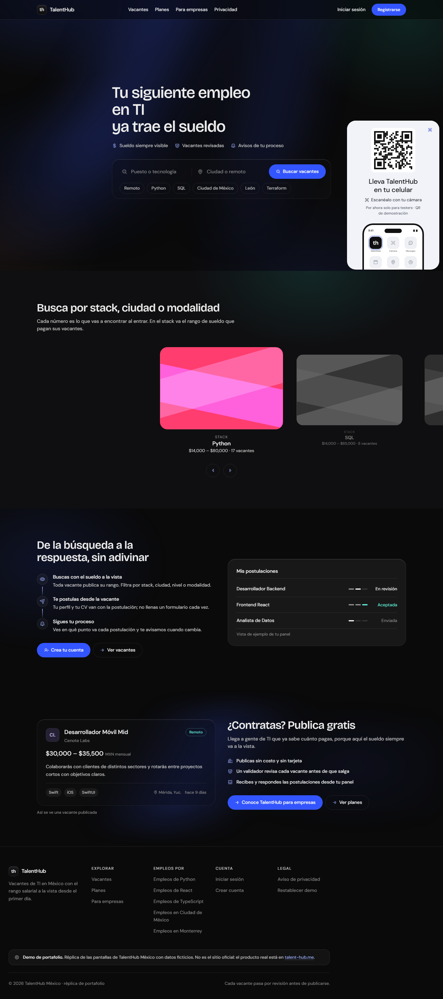
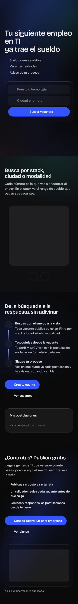

## 2. Vacantes — `vacantes.html`

**Objetivo:** encontrar vacantes relevantes rápido. **Usuario:** candidato.
**Flujo:** escribir → filtrar → paginar → abrir detalle.

- **Búsqueda en vivo** con espera de 250 ms y sin distinguir acentos ni mayúsculas («merida»
  encuentra «Mérida»): tolera cómo escribe la gente (H5).
- **Filtros de un toque arriba** (modalidad) y **los avanzados detrás de «Más filtros» en móvil**
  (tecnología, nivel, rango): en 390 px los resultados no quedan empujados fuera de la pantalla
  (mobile-first, H8). El botón muestra cuántos filtros avanzados hay activos (H1).
- **Rango salarial de doble manija** con dos `input range` nativos: teclado y lector de pantalla
  funcionan sin código extra; las manijas no se cruzan.
- **Opciones derivadas de los datos**: nunca se ofrece un filtro que dé cero resultados por
  diseño.
- **Paginación numerada** con «Ves 13–24 de 62»; al cambiar de página el foco va al encabezado de
  resultados para que el lector de pantalla no se pierda.
- **Estado vacío con salida**: «Ninguna vacante coincide» + «Limpiar filtros» (H9).

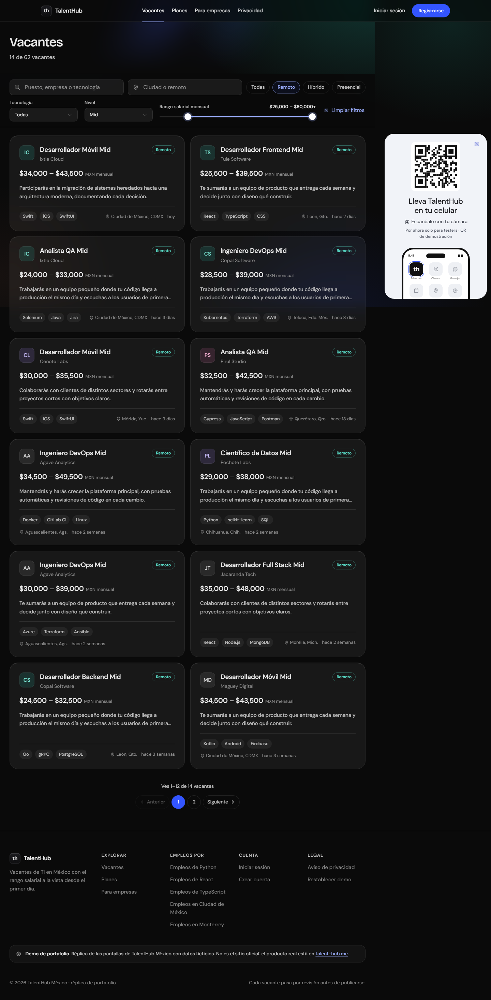

| Cargando (servidor dormido) | Vacío | Error |
|---|---|---|
| 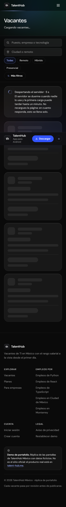 | 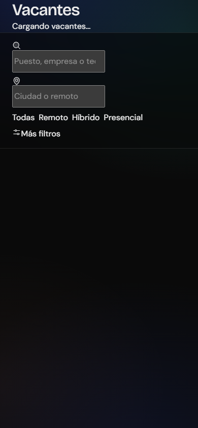 | 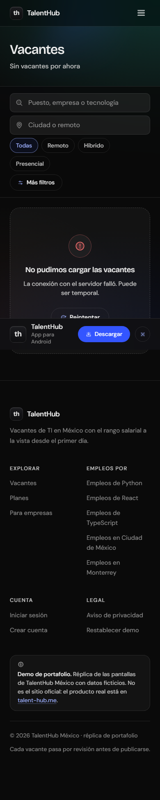 |

## 3. Detalle de vacante — `vacante.html`

**Objetivo:** decidir si postularse. **Usuario:** candidato (y empresa para revisar su vacante).
**Flujo:** leer sueldo y requisitos → postularse.

- **Jerarquía:** empresa y puesto → sueldo (arriba a la derecha, la cifra más grande) → resumen →
  requisitos → descripción. Lo que decide va primero.
- **Banda y skeleton desde el primer cuadro**: nada salta al llegar los datos (CLS bajo).
- **La tarjeta de acción cambia por rol**: visitante → iniciar sesión (y vuelve a esta vacante con
  `?volver=`); candidato → «Postularme»; ya postulado → «Ya te postulaste» (H1); empresa → aviso de
  que las empresas no se postulan.
- **Tarjeta fija** al hacer scroll en escritorio: la acción siempre está a la mano (H7).
- **Diálogo de postulación**: CV del perfil por defecto (no repetir datos, H6), PDF ≤ 5 MB validado
  al elegirlo, consentimiento explícito y mensaje opcional con contador.

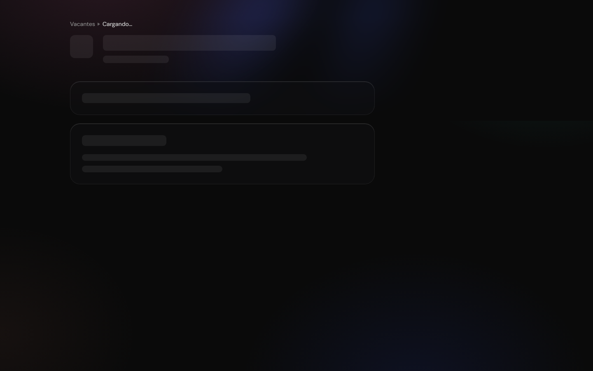

## 4. Planes — `planes.html`

**Objetivo:** comparar planes y entender que no hay permanencia. **Usuario:** ambos.

- **Garantías arriba** (sin permanencia, cambio al momento) antes del precio: reduce la ansiedad de
  compra.
- **Planes apilados por tipo de cuenta** como en el original, no en pestañas: comparar todo en una
  pantalla es más fácil que recordar lo de la otra pestaña (H6).
- **Plan actual marcado** si hay sesión (H1). «Contratar» explica que la demo no procesa pagos.

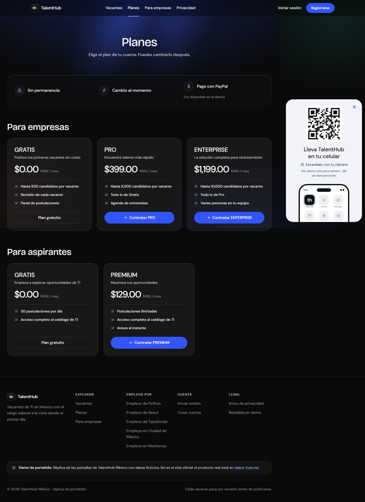

## 5. Para empresas — `empresas.html`

**Objetivo:** convencer a quien contrata de publicar. **Usuario:** empresa.

- **Producto real en lugar de fotos de stock**: una vacante de la demo y una postulación de
  ejemplo, etiquetada como tal.
- **Tres pasos** (publicas → validador → respondes): explica el proceso completo antes de pedir
  nada (H10).
- **Identidad propia** (grano azul-violeta) para que no se lea igual que el inicio.

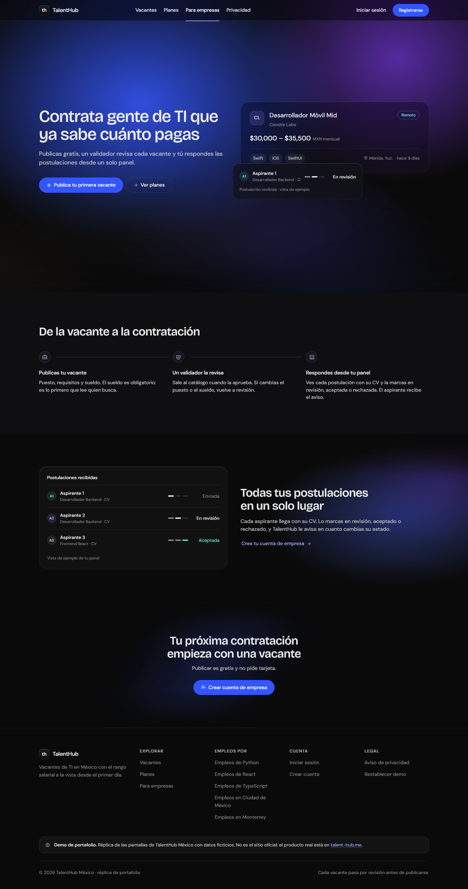

## 6. Iniciar sesión, registro y recuperar — `login.html`, `registro.html`, `recuperar.html`

**Objetivo:** entrar o crear cuenta sin distracciones. **Usuario:** ambos.

- **Pantallas cerradas** (sin nav ni footer): la única salida útil es la que da la página (H8).
- **Maquetas honestas**: el aviso «Demo de portafolio» está visible, no envían ni guardan nada,
  y la contraseña se borra del campo al enviar. Accesos de un clic a las cuentas demo.
- **Tipo de cuenta como tarjetas de opción** (radiogroup real): con dos opciones que ramifican el
  formulario, ambas deben verse; un `<select>` escondería la mitad de la decisión.
- **Reglas de contraseña que se marcan al cumplirse** (H1, H5) y se anuncian como «cumplido /
  pendiente» a lectores de pantalla. El botón no se deshabilita: un botón gris no explica qué
  falta; al enviar, cada error aparece junto a su campo.
- **Validación al salir del campo**, no mientras se escribe por primera vez: no se regaña a quien
  aún no termina.

| Login | Registro |
|---|---|
| 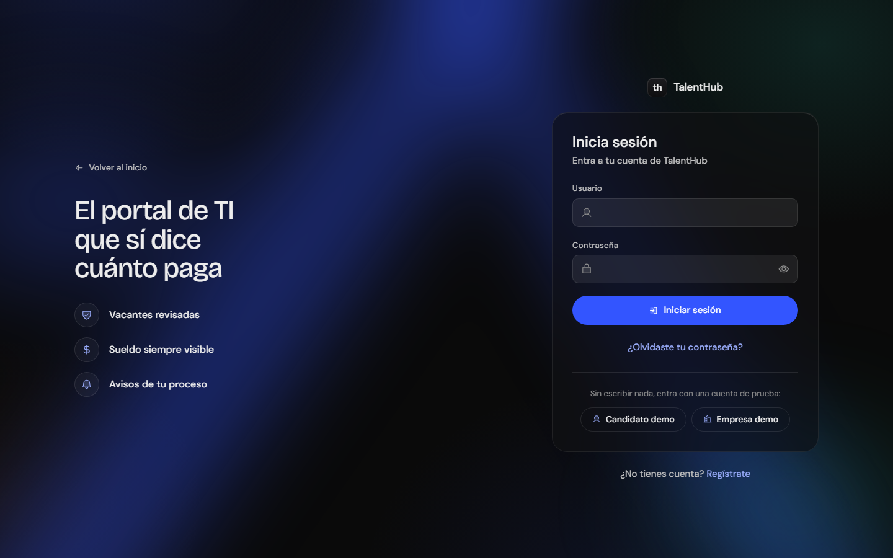 | 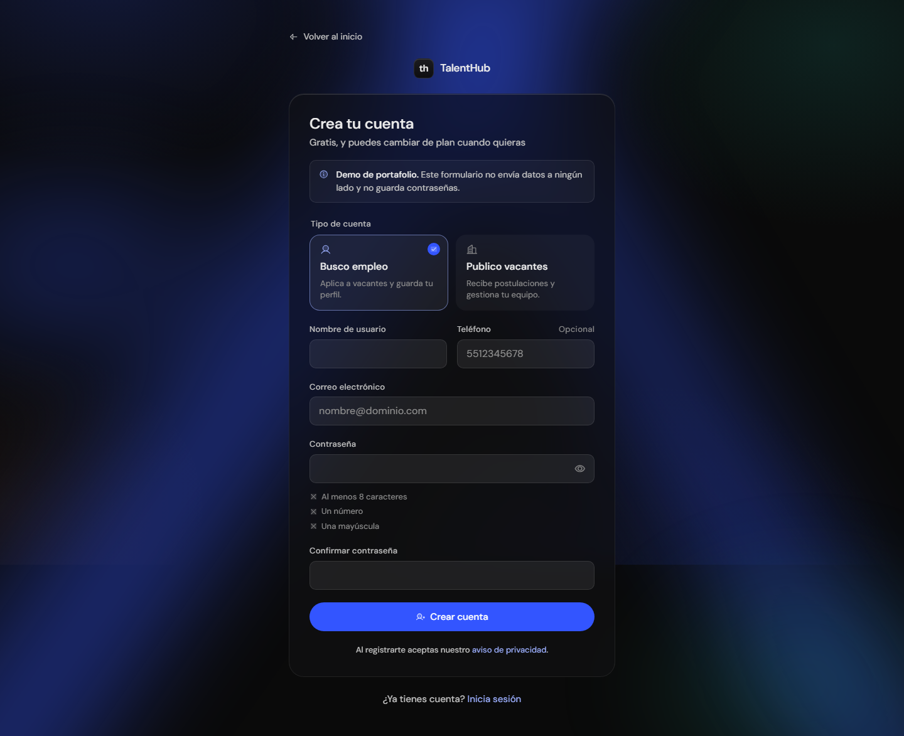 |

## 7. Mis postulaciones — `mis-postulaciones.html`

**Objetivo:** saber en qué va cada proceso sin tener que preguntar. **Usuario:** candidato.

- **ProcessTrack** en lugar de un punto de color con etiqueta: tres segmentos llenos hasta el paso
  alcanzado; solo el último lleva color. Se entiende sin color (WCAG 1.4.1).
- **Métricas arriba** (total, en revisión, aceptadas): resumen antes del detalle.
- **Historial en `
`**: disponible sin saturar la lista; se abre con teclado sin JS extra.
- **Entrevista visible** en la tarjeta cuando existe (H1).

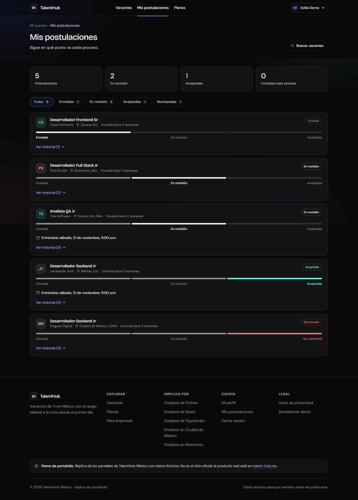

## 8. Mi perfil — `perfil.html`

**Objetivo:** tener el perfil listo para postularse con un clic. **Usuario:** candidato.

- **Resumen lateral** de cómo te ven las empresas, con huecos explícitos («Sin teléfono»,
  «Aún no subes tu CV»): reconocer lo que falta (H6).
- **Barra «Cambios sin guardar»** solo cuando hay cambios, con Descartar y Guardar; aviso del
  navegador si sales con cambios (H3, H5).
- **Habilidades como chips**: Enter o coma para añadir, × o Retroceso para quitar.

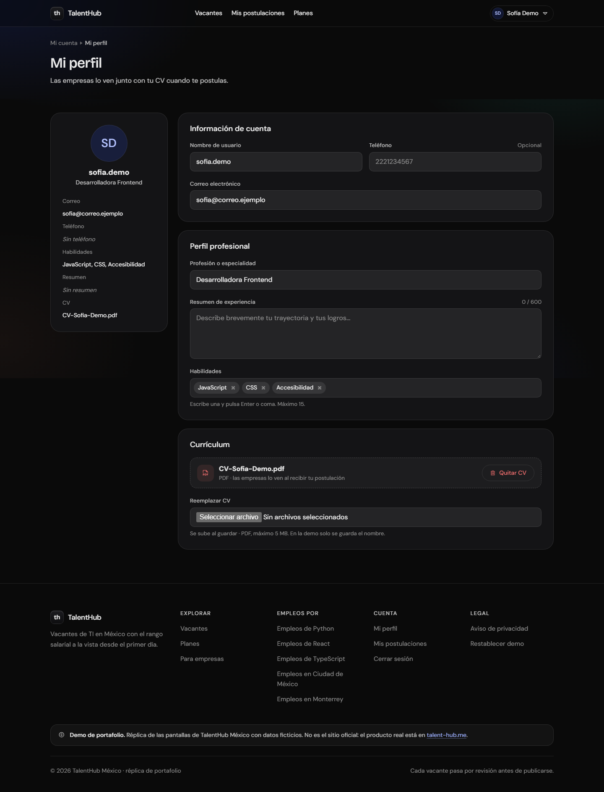

## 9. Mis vacantes — `empresa/vacantes.html`

**Objetivo:** ver de un vistazo el estado de cada vacante y sus postulaciones. **Usuario:** empresa.

- **Estados de la vacante** (Publicada, En revisión, Pausada) con texto explicativo en «En
  revisión» (H1, H10).
- **El enlace a postulaciones dice cuántas hay y cuántas son nuevas**: la acción más frecuente es
  la más visible.
- **Pausar ≠ eliminar**: pausar es reversible y directo; eliminar exige mantener y confirma
  cuántas personas se enteran.

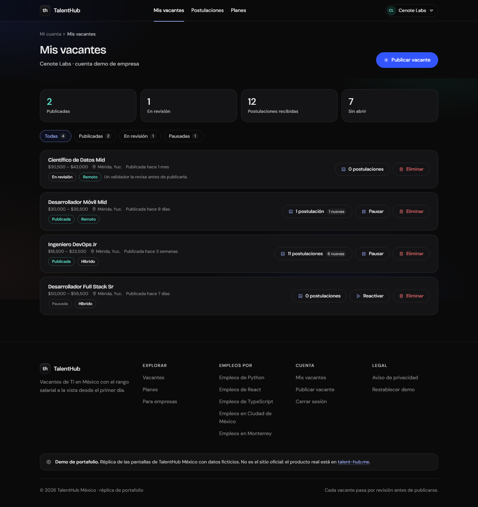

## 10. Publicar vacante — `empresa/publicar.html`

**Objetivo:** publicar una vacante completa y correcta a la primera. **Usuario:** empresa.

- **Vista previa en vivo** de la tarjeta tal como la verá el candidato: la empresa ve el
  resultado mientras escribe (H1, H6).
- **Sueldo obligatorio**, máximo ≥ mínimo, al menos una tecnología: los errores se previenen y se
  explican junto al campo (H5, H9). Errores nativos y propios aparecen a la vez, no uno por uno.
- **Aviso de revisión antes de enviar**: la persona sabe qué pasa después (H10).

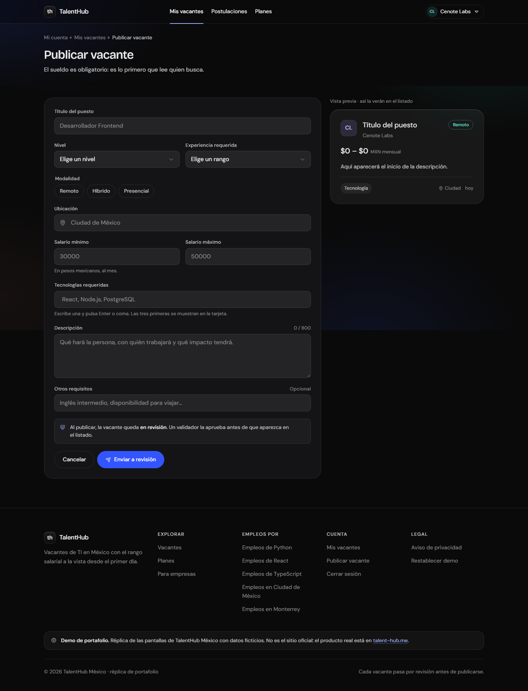

## 11. Postulaciones recibidas — `empresa/postulaciones.html`

**Objetivo:** responder rápido y con cuidado. **Usuario:** empresa.

- **Las acciones cambian según el estado** (marcar en revisión → aceptar o rechazar → agendar
  entrevista o reabrir): solo se ofrece lo posible en cada momento (H5, H8).
- **El contacto se revela al aceptar**: protege los datos de quien todavía no avanza.
- **Rechazar exige mantener presionado** y el diálogo cambia si hay entrevista agendada («¿Rechazar
  y cancelar la entrevista?»).
- **Filtro por estado y por vacante en la URL**: se puede volver al mismo punto (H3).

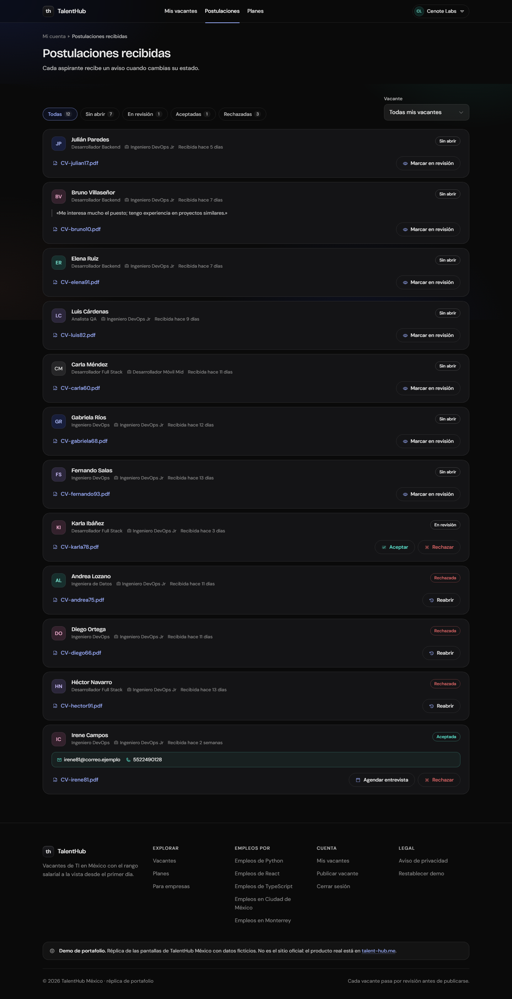

## 12. Aviso de privacidad y 404 — `privacidad.html`, `404.html`

- **Privacidad**: texto propio, corto y en lenguaje claro sobre qué guarda la demo; índice fijo en
  escritorio (H6) y botón para borrar los datos.
- **404**: el número gigante es ilustración (`aria-hidden`); el `h1` real dice qué pasó, y hay tres
  salidas: vacantes, inicio y buscador (H9).

| Privacidad | 404 |
|---|---|
| 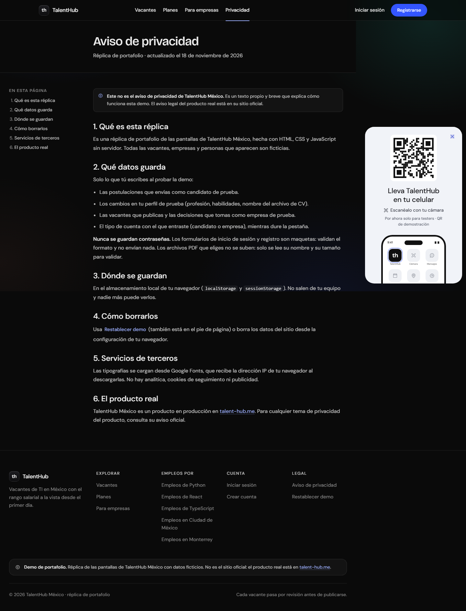 | 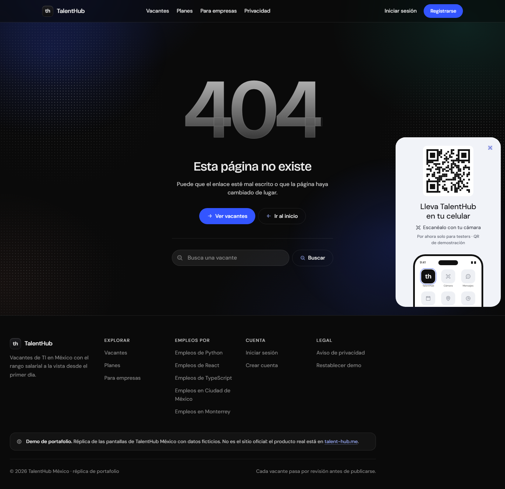 |

## Verificación

- **Responsivo**: 20 pantallas y estados sin desbordamiento horizontal a 390, 768 y 1440 px
  (`python tools/capturas.py --revisar`).
- **Accesibilidad**: 0 errores en la auditoría propia (contraste AA de todo el texto visible,
  nombres accesibles, etiquetas, IDs únicos, un `h1`, jerarquía de encabezados) en las mismas 20
  pantallas (`tools/auditoria.js`).
- **Teclado**: menús, diálogos, botones de mantener presionado, chips y carrusel probados sin ratón.
- **Pendiente honesto**: no se probó con lectores de pantalla reales (NVDA, VoiceOver); la
  auditoría automática no sustituye esa prueba.
